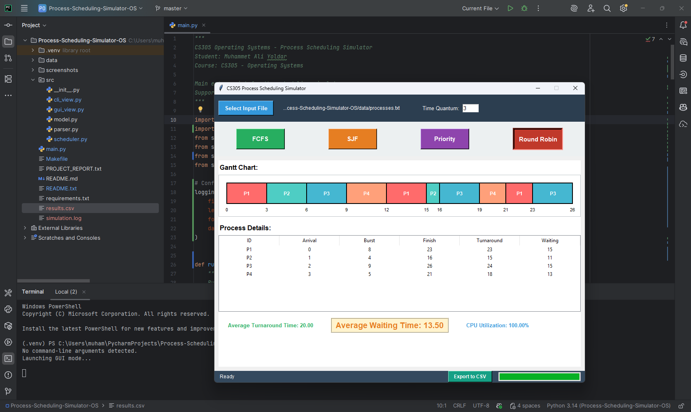
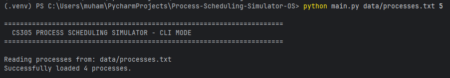
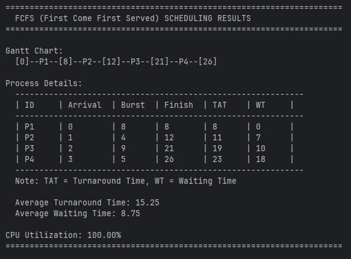
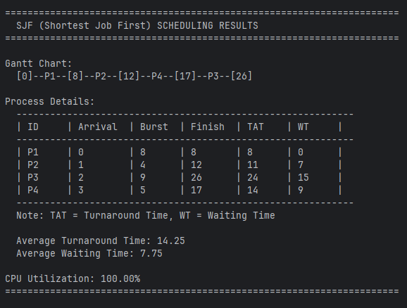
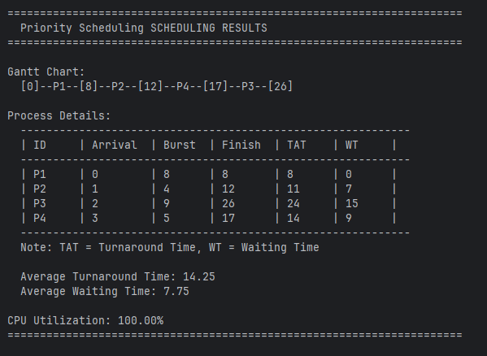
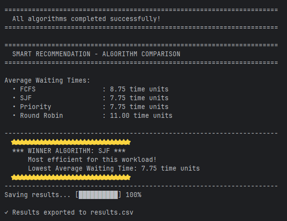
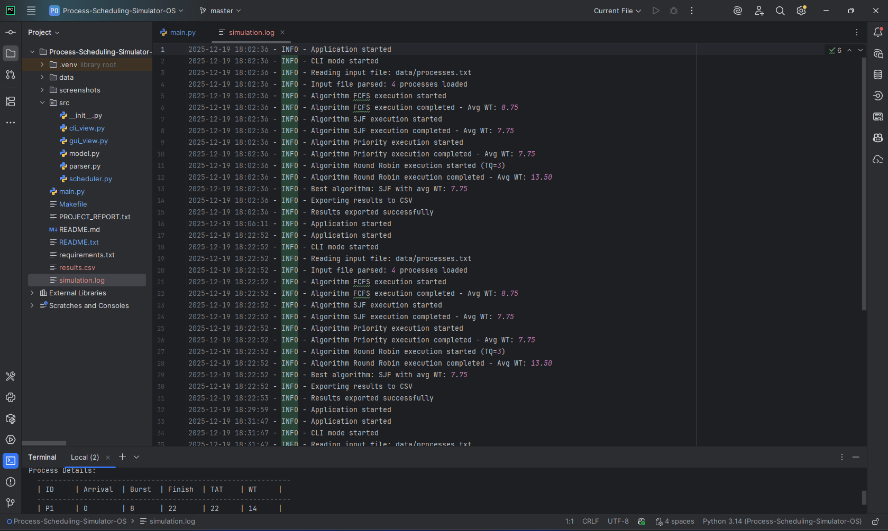
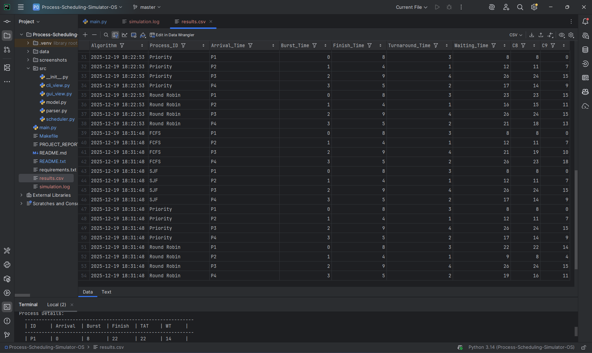

# CS305 Process Scheduling Simulator

A CPU scheduling simulator with two interfaces, a command line and a Tkinter GUI, that runs **FCFS, SJF, Priority and Round Robin** on the same workload and compares them by waiting time, turnaround time and CPU utilization. Written for the CS305 Operating Systems course using only the Python standard library.



## Features

- **Four algorithms**: FCFS, SJF (non-preemptive), Priority (non-preemptive, lower number = higher priority) and Round Robin with a configurable time quantum (default 3).
- **Two modes from one entry point**: `python main.py` opens the GUI; `python main.py <file> [quantum]` runs all four algorithms in the terminal.
- **Gantt charts**: color-coded on a canvas in the GUI, ASCII in the terminal, including idle periods.
- **Metrics**: per-process finish, turnaround and waiting time; average waiting and turnaround time; CPU utilization.
- **Recommendation**: in CLI mode the algorithm with the lowest average waiting time is announced as the winner.
- **CSV export**: CLI runs append to `results.csv`, the GUI's export button appends to `gui_results.csv` (a header row is written only when the file is new).
- **Logging**: every run writes timestamped events (startup, parsing, each algorithm, export) to `simulation.log`.

## Tech stack

Python 3 standard library only: `tkinter`/`ttk` for the GUI, `csv`, `logging`. `requirements.txt` lists no packages. (Linux distributions may need the `python3-tk` package for Tkinter.)

## Project structure

```
main.py              # entry point: GUI without arguments, CLI with a file argument
Makefile             # run, run-tq, gui, clean
src/
├── model.py         # Process data structure
├── parser.py        # input file parsing (comments with #, 4 fields per line)
├── scheduler.py     # run_fcfs, run_sjf, run_priority, run_rr
├── cli_view.py      # terminal tables, ASCII Gantt chart, metrics, CSV export
└── gui_view.py      # Tkinter GUI: file picker, quantum input, Gantt canvas, export
data/                # sample workloads
├── processes.txt    # instructor's example
├── starvation.txt   # priority starvation demonstration
├── idle_test.txt    # CPU idle periods (arrival gaps)
├── ties.txt         # tie-breaking when processes arrive together
└── rr_heavy.txt     # Round Robin stress test
screenshots/         # images used in this README
README.txt           # plain-text submission notes
PROJECT_REPORT.txt   # project report
```

## Installation

```bash
git clone https://github.com/muhammetaliyoldar/Process-Scheduling-Simulator-OS.git
cd Process-Scheduling-Simulator-OS
python main.py
```

## Usage

### GUI

```bash
python main.py        # or: make gui
```

Pick an input file, set the time quantum, then run any algorithm with its button. The process table, averages and Gantt chart update for each run; the export button saves the current results.

### CLI

```bash
python main.py data/processes.txt       # all four algorithms, quantum 3 (make run)
python main.py data/processes.txt 4     # custom Round Robin quantum   (make run-tq)
python main.py data/starvation.txt      # watch the low-priority process starve
```



Each algorithm prints a process table, an ASCII Gantt chart and its averages:

| FCFS | SJF |
|---|---|
|  |  |
| **Priority** | **Round Robin (TQ = 5)** |
|  | .png) |

The run ends with the comparison and the winner:



## Makefile targets

| Target | Command |
|---|---|
| `make run` | `python main.py data/processes.txt` |
| `make run-tq` | `python main.py data/processes.txt 4` |
| `make gui` | `python main.py` |
| `make clean` | remove `__pycache__` and `.pyc` / `.pyo` files |

## Input format

Plain text, one process per line:

```
# Process_ID,Arrival_Time,Burst_Time,Priority
P1,0,8,3
P2,1,4,1
P3,2,9,4
P4,3,5,2
```

Lines starting with `#` and empty lines are ignored. Lower priority numbers mean higher priority.

## Output files

| File | Written by | Content |
|---|---|---|
| `simulation.log` | every run | timestamped event log |
| `results.csv` | CLI mode | `Timestamp,Algorithm,Process_ID,Arrival,Burst,Priority,Finish,Turnaround,Waiting` |
| `gui_results.csv` | GUI export button | same columns |




## Assumptions and limitations

- Context-switch overhead is zero; processes are CPU-bound with no I/O bursts.
- Ties in burst time or priority are broken by arrival time.
- No aging, so Priority scheduling can starve low-priority processes (see `data/starvation.txt`).

## Project status

Course project for CS305 Operating Systems (Türk Hava Kurumu University), completed and committed on 19 December 2025. The `results.csv` and `simulation.log` in the repository are sample outputs; the committed `results.csv` still has the older header without `Timestamp`/`Priority`, so delete it before collecting new results. There is no license file in the repository.

## Author

Muhammet Ali Yoldar
